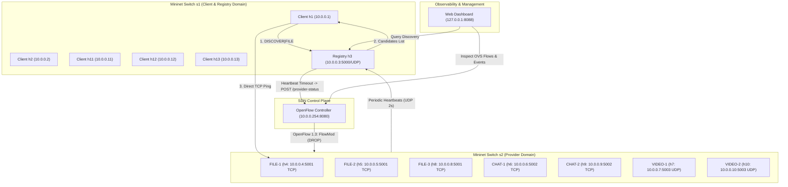

# SDN-Integrated Dynamic Service Discovery System

[](https://github.com/service-discovery/sdn-service-discovery/actions/workflows/ci.yml)
[](https://www.python.org/downloads/)
[](LICENSE)
[](https://opennetworking.org/)
[](http://mininet.org/)

An enterprise-grade, SDN-integrated dynamic service discovery architecture combining an **OpenFlow 1.3 SDN controller**, a central **UDP-based Service Registry**, multi-protocol microservice providers (**TCP/UDP**), a fault-tolerant discovery client, an interactive **real-time Web Dashboard**, and an automated **Benchmarking & Telemetry Suite**.

---

## Table of Contents

- [Overview](#overview)
- [System Architecture](#system-architecture)
- [Mininet Network Topology & Host Map](#mininet-network-topology--host-map)
- [Key Features](#key-features)
- [Directory Structure](#directory-structure)
- [Prerequisites & Installation](#prerequisites--installation)
- [Quick Start](#quick-start)
  - [1. Running Standalone Unit Tests](#1-running-standalone-unit-tests)
  - [2. One-Click Automated Demo inside Mininet VM](#2-one-click-automated-demo-inside-mininet-vm)
  - [3. Manual Mininet Launch & Step-by-Step Execution](#3-manual-mininet-launch--step-by-step-execution)
- [Web Dashboard](#web-dashboard)
- [Benchmarking & Evaluation](#benchmarking--evaluation)
- [CI/CD](#cicd)
- [Contributing](#contributing)
- [License](#license)

---

## Overview

Traditional microservice architectures rely on client-side or DNS-based discovery without awareness of network-layer health. This system integrates the application-level discovery layer with the **Software-Defined Networking (SDN) data plane**:

1. **Service Providers** register with a central Registry and continuously stream UDP heartbeats.
2. The **Registry** monitors provider health, maintains round-robin or first-available routing policies, and automatically signals status transitions to an **SDN Controller via REST API**.
3. The **OpenFlow SDN Controller** immediately installs or removes OpenFlow drop rules on switch `s2`, instantly blocking network traffic to dead/unhealthy providers at line rate.
4. **Clients** query the registry, measure registry round-trip latency, connect directly to healthy providers, and gracefully fall back across provider candidates.
5. A **Live Web Dashboard** visualizes the topology, animates discovery packets, monitors active OVS flow tables, and provides interactive lifecycle fault injection.

---

## System Architecture



---

## Mininet Network Topology & Host Map

The network topology consists of 13 hosts connected across two Open vSwitch bridges (`s1` and `s2`):

| Host | IP Address | Role | Transport & Port | Description |
|---|---|---|---|---|
| **h1** | `10.0.0.1` | Client | — | Dedicated benchmark & CLI client |
| **h2** | `10.0.0.2` | Client | — | Dedicated benchmark & CLI client |
| **h11** | `10.0.0.11` | Client | — | Dedicated benchmark & CLI client |
| **h12** | `10.0.0.12` | Client | — | Dedicated benchmark & CLI client |
| **h13** | `10.0.0.13` | Client | — | Dedicated benchmark & CLI client |
| **h3** | `10.0.0.3` | Service Registry | UDP `5000` | Central service discovery registry |
| **h4** | `10.0.0.4` | Provider `FILE-1` | TCP `5001` | High-availability file service |
| **h5** | `10.0.0.5` | Provider `FILE-2` | TCP `5001` | High-availability file service |
| **h8** | `10.0.0.8` | Provider `FILE-3` | TCP `5001` | High-availability file service |
| **h6** | `10.0.0.6` | Provider `CHAT-1` | TCP `5002` | Text chat messaging service |
| **h9** | `10.0.0.9` | Provider `CHAT-2` | TCP `5002` | Text chat messaging service |
| **h7** | `10.0.0.7` | Provider `VIDEO-1` | UDP `5003` | Real-time video frame streaming |
| **h10** | `10.0.0.10` | Provider `VIDEO-2` | UDP `5003` | Real-time video frame streaming |
| **sdn-root** | `10.0.0.254` | SDN Controller | HTTP `8080` | OpenFlow 1.3 controller & REST API |

---

## Key Features

- **Dynamic Service Registry (`registry/`)**:
  - Handles `REGISTER`, `HEARTBEAT`, and `DISCOVER` commands over UDP.
  - Thread-safe `ProviderStore` supporting both `FIRST_AVAILABLE` and `ROUND_ROBIN` load balancing policies.
  - Automatic provider heartbeat tracking with configurable timeout detection.
  - Asynchronous event dispatcher notifying the SDN controller upon `ACTIVE` and `INACTIVE` state transitions.

- **OpenFlow SDN Controller (`integration/controller.py`)**:
  - Built on `os-ken` (Ryu fork) supporting OpenFlow 1.3.
  - Exposes HTTP REST API (`/provider-status`) to receive health state updates from the Registry.
  - Dynamically creates high-priority `OFPFlowMod` drop rules on `s2` targeting failed provider IP/protocol/ports.
  - Removes drop rules seamlessly when providers send valid heartbeats and recover.

- **Multi-Protocol Service Providers (`providers/provider.py`)**:
  - Configurable standalone service instances with automatic registration.
  - Sends heartbeats every 2 seconds.
  - Supports TCP services (`FILE`, `CHAT`) and UDP streaming (`VIDEO`).
  - Integrated local UDP lifecycle listener (`UDP 55000`) enabling authenticated failure simulation (`PAUSE_HEARTBEATS` / `RESUME_HEARTBEATS`).

- **Intelligent Discovery Client (`client/client.py`)**:
  - High-precision discovery latency measurement using `time.perf_counter()`.
  - Sequential candidate fallback without changing Registry state.
  - Strict same-service fallback guarantee.

- **Zero-Dependency Web Dashboard (`frontend/app.py`)**:
  - Built with pure Python standard library HTTP server + modern responsive CSS/JS.
  - Real-time topological graph with active packet animation and provider statuses.
  - Live event stream showing heartbeat transitions, registration events, and discovery calls.
  - Live OpenFlow rule table inspector querying `ovs-ofctl`.
  - Interactive fault injection controls to pause/resume provider heartbeats.

- **Benchmarking & Analysis Suite (`benchmark/`)**:
  - Compares dynamic service discovery against direct static communication.
  - Configurable concurrency, requests per client, and timeout settings.
  - Computes mean & P95 latency, throughput (req/sec), and success rates.
  - Automated graph and chart generation.

---

## Directory Structure

```text
.
├── .github/
│   └── workflows/
│       └── ci.yml               # GitHub Actions CI workflow
├── benchmark/
│   ├── analyze_results.py       # Metrics processing & graph generator
│   ├── benchmark_runner.py      # Multi-process discovery benchmark harness
│   ├── README.md                # Benchmarking guidelines
│   └── tests/                   # Benchmark harness unit tests
├── benchmark-results/           # Sample & experimental workload results (JSON/CSV)
├── client/
│   └── client.py                # Discovery & service communication client CLI
├── docs/
│   ├── T3_HANDOVER.md           # Engineering handover notes & specs
│   └── TEST_REPORT.md           # Test execution and verification report
├── frontend/
│   ├── app.py                   # Standalone dashboard server & bridge
│   ├── workloads.py             # Workload coordinator for dashboard
│   └── README.md                # Dashboard usage documentation
├── integration/
│   ├── controller.py            # OpenFlow 1.3 SDN controller (os-ken)
│   ├── run_controller.py        # Controller runner script
│   ├── start_demo.py            # One-click automated Mininet demo launcher
│   ├── topology.py              # Mininet 13-host 2-switch network definition
│   ├── test_sdn_failure_recovery.py # Automated SDN failover test script
│   ├── concurrent_discovery.mn  # Mininet batch script for concurrency test
│   ├── INTEGRATION_README.md    # Detailed integration runbook
│   └── tests/                   # Integration unit tests
├── providers/
│   ├── provider.py              # Multi-protocol service provider implementation
│   ├── provider_telemetry.py    # Provider telemetry helper
│   └── tests/                   # Provider lifecycle & communication tests
├── registry/
│   ├── registry.py              # UDP service registry entrypoint
│   ├── provider_store.py        # Thread-safe provider inventory & policy
│   ├── protocol.py              # Wire-protocol formatter and parser
│   ├── config.py                # Registry configuration
│   ├── controller_client.py     # REST client for controller notifications
│   ├── registry_telemetry.py    # Discovery event accounting
│   ├── README.md                # Registry architecture notes
│   ├── tools/                   # Registry CLI utilities (send, test tools)
│   └── tests/                   # Registry protocol, concurrency & store tests
├── tests/                       # Client & frontend bridge unit tests
├── CONTRIBUTING.md               # Contribution guidelines
├── LICENSE                       # MIT License
├── pyproject.toml               # Python project configuration
├── README.md                    # Main repository documentation
├── README_T3.md                 # T3 application handover specification
├── requirements.txt             # Core runtime dependencies
└── requirements-dev.txt         # Development & testing dependencies
```

---

## Prerequisites & Installation

### Local Development (Host OS)
Any OS with **Python 3.10+**:
```bash
git clone https://github.com/service-discovery/sdn-service-discovery.git
cd sdn-service-discovery

python3 -m venv .venv
source .venv/bin/activate
pip install -r requirements-dev.txt
```

### Mininet & SDN Simulation (Linux VM)
For running the OpenFlow SDN controller and network topology:
- **OS**: Ubuntu 22.04 LTS (recommended)
- **Packages**:
  ```bash
  sudo apt-get update
  sudo apt-get install -y mininet openvswitch-switch openvswitch-testcontroller net-tools
  pip install os-ken Pillow
  ```

---

## Quick Start

### 1. Running Standalone Unit Tests

Run all unit tests locally (no root or Mininet required):

```bash
# 1. Registry protocol, storage and concurrency tests (31 tests)
python3 -m unittest discover -s registry/tests -v

# 2. Client fallback, discovery latency and dashboard bridge tests (66 tests)
python3 -m unittest discover -s tests -v

# 3. Provider registration and lifecycle tests (7 tests)
python3 -m unittest discover -s providers/tests -v

# 4. Benchmark runner and analysis tests (13 tests)
python3 -m unittest discover -s benchmark/tests -v
```

---

### 2. One-Click Automated Demo inside Mininet VM

To launch the complete environment (Controller, Switches, Registry, 7 Providers, and Mininet CLI) with one command:

```bash
sudo python3 integration/start_demo.py
```

This sets up:
- The `os-ken` OpenFlow controller in the background.
- Switch `s1` and `s2` with the 13 Mininet hosts.
- Service Registry listening on `10.0.0.3:5000`.
- All 7 service providers running and registered.
- Interactive Mininet CLI prompt.

To stop the entire demo cleanly from another terminal:
```bash
sudo python3 integration/start_demo.py --stop
```

---

### 3. Manual Mininet Launch & Step-by-Step Execution

#### Step 1: Start the SDN Controller
```bash
sudo python3 integration/run_controller.py
```

#### Step 2: Start Mininet Topology
In a second terminal:
```bash
sudo python3 integration/topology.py
```

#### Step 3: Start Registry on h3
From the Mininet CLI:
```text
mininet> h3 env CONTROLLER_URL=http://10.0.0.254:8080/provider-status python3 registry/registry.py > /tmp/registry.log 2>&1 &
```

#### Step 4: Start Providers
From the Mininet CLI:
```text
mininet> h4 python3 providers/provider.py --id FILE-1 --service FILE --host 10.0.0.4 --port 5001 --lifecycle-token-file /tmp/service_discovery_lifecycle.token > /tmp/file1.log 2>&1 &
mininet> h5 python3 providers/provider.py --id FILE-2 --service FILE --host 10.0.0.5 --port 5001 --lifecycle-token-file /tmp/service_discovery_lifecycle.token > /tmp/file2.log 2>&1 &
mininet> h8 python3 providers/provider.py --id FILE-3 --service FILE --host 10.0.0.8 --port 5001 --lifecycle-token-file /tmp/service_discovery_lifecycle.token > /tmp/file3.log 2>&1 &
mininet> h6 python3 providers/provider.py --id CHAT-1 --service CHAT --host 10.0.0.6 --port 5002 --lifecycle-token-file /tmp/service_discovery_lifecycle.token > /tmp/chat1.log 2>&1 &
mininet> h9 python3 providers/provider.py --id CHAT-2 --service CHAT --host 10.0.0.9 --port 5002 --lifecycle-token-file /tmp/service_discovery_lifecycle.token > /tmp/chat2.log 2>&1 &
mininet> h7 python3 providers/provider.py --id VIDEO-1 --service VIDEO --host 10.0.0.7 --port 5003 --lifecycle-token-file /tmp/service_discovery_lifecycle.token > /tmp/video1.log 2>&1 &
mininet> h10 python3 providers/provider.py --id VIDEO-2 --service VIDEO --host 10.0.0.10 --port 5003 --lifecycle-token-file /tmp/service_discovery_lifecycle.token > /tmp/video2.log 2>&1 &
```

#### Step 5: Execute Client Discovery & Operations
From the Mininet CLI:
```text
mininet> h1 python3 client/client.py FILE --request PING
# Output:
# Discovery latency (FILE): 0.842 ms
# Contacting FILE-1 (10.0.0.4:5001)...
# FILE-1 OK service=FILE request=PING

mininet> h1 python3 client/client.py CHAT --request 'Hello CHAT-1'
mininet> h1 python3 client/client.py VIDEO --request 'GET_FRAME 1'
```

---

## Web Dashboard

The system features a browser-based visualization dashboard:

```bash
sudo python3 frontend/app.py --host 0.0.0.0 --port 8088
```

Open your browser at `http://127.0.0.1:8088`.

### Dashboard Features
1. **Interactive Topology**: Real-time canvas diagram showing switch links, client nodes, and active provider statuses.
2. **Packet Animation**: Visual representation of client discovery requests and responses traversing the network.
3. **Live OVS Flow Table**: Live query of OpenFlow rules on switches `s1` and `s2`.
4. **Lifecycle Fault Injection**: One-click pause and resume of provider heartbeats to simulate failures.
5. **Real-time Event Timeline**: Streaming log of registry transitions, discovery operations, and controller drops.

---

## Benchmarking & Evaluation

The benchmark suite evaluates discovery latency, throughput, and error rates across different load balancing policies.

### Run Discovery Benchmark
```bash
# 10 clients, 20 requests each, Round-Robin policy:
python3 benchmark/benchmark_runner.py --clients 10 --requests 20 --max-concurrency 5 --service FILE --policy ROUND_ROBIN
```

### Analyze Results & Generate Charts
```bash
python3 benchmark/analyze_results.py benchmark-results/workload_<run-id>.json
```

To compare policies side-by-side:
```bash
python3 benchmark/analyze_results.py \
  benchmark-results/benchmark_first_available.json \
  benchmark-results/benchmark_round_robin.json \
  --compare-policies
```

---

## CI/CD

Continuous Integration is configured via [GitHub Actions](.github/workflows/ci.yml). On every push and pull request to `main`:
- Automated test matrix across Python `3.10`, `3.11`, `3.12`, and `3.13`.
- Code linting with `ruff`.
- Complete execution of all unit test suites (`registry/tests`, `tests`, `benchmark/tests`, `providers/tests`).

---

## Contributing

Contributions, bug reports, and pull requests are welcome! Please see [CONTRIBUTING.md](CONTRIBUTING.md) for details on code style, testing, and contribution workflow.

---

## License

This project is licensed under the [MIT License](LICENSE).

